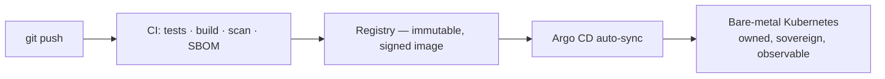

# Belhadj Kessas

### Senior DevOps & Platform Infrastructure Engineer
**I build the infrastructure cities run on** — sovereign, open source end to end,
with no hyperscaler dependency and no proprietary lock-in.

---

I design and operate digital infrastructure that organizations own outright:
bare-metal Linux, Kubernetes and GitOps, without vendor lock-in. Everything is
reconciled from Git — no manual changes, one source of truth.

## 🏙️ Flagship — Montpellier Méditerranée Métropole Smart City

A live municipal platform serving **500,000+ citizens** with **100,000+ IoT
sensors** across air quality, waste, water, energy and mobility — four
Kubernetes clusters, GitOps-managed, on entirely owned infrastructure.

## What I work with

- **Kubernetes & platform** — RKE2, Rancher, MetalLB, Rook-Ceph, Cilium (eBPF),
  Envoy Gateway, Helm
- **GitOps & IaC** — Argo CD, GitLab CI/CD, OpenTofu, Terraform, Ansible
- **IoT & networking** — LoRaWAN at scale, RF planning, VLAN segmentation,
  fleet provisioning, OTA updates
- **Observability & SRE** — Mimir, Loki, Grafana, Grafana Alloy, Zabbix
- **Programming** — Python (Django), Rust, Bash
- **Exploring** — computer vision (YOLO), GPU scheduling, Kubeflow

## Open source

- [**OpenHertz / Spectra**](https://github.com/beladjioo/Spectra) — gamified
  radio learning over SDR: browser-based decoding, Rust/TypeScript DSP, and
  amateur-radio exam prep
- [**chirpstack-v4-kubernetes**](https://github.com/beladjioo/chirpstack-v4-kubernetes) —
  ChirpStack v4 LoRaWAN server on Kubernetes

## Certifications

- **CKA** — Certified Kubernetes Administrator *(in progress, 2026 · CNCF)*

## Let's talk

Available for freelance work: sovereign Kubernetes/GitOps platform builds,
LoRaWAN & IoT deployments, and infrastructure audits.

🌐 [belhadj.dev](https://belhadj.dev) · 💼 [LinkedIn](https://linkedin.com/in/belhadj-k) · ✉️ contact@belhadj.dev · 📍 Montpellier, France
