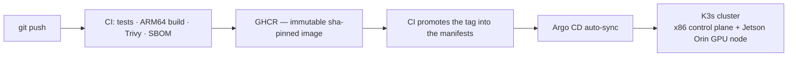

# Hi, I'm Belhadj 👋

**Platform engineer — GitOps · Kubernetes · IoT/edge · RF.**
I run everything I build as code, on infrastructure I operate myself.

## What I run

A self-hosted production platform, 100 % GitOps — most of it lives in 20+
private repos, all operated the same way:

- **K3s cluster** (x86 + NVIDIA Jetson Orin edge node) reconciled by **Argo CD** —
  no manual `kubectl apply`, Git is the only source of truth
- **Supply chain**: immutable sha-pinned images, Trivy scans, SBOMs,
  Sealed Secrets — zero plaintext secrets in Git
- **Observability**: Prometheus / Grafana / Alertmanager with push alerts
  in under a minute when a nightly job fails
- **Workloads**: AI content pipelines on CUDA (edge GPU), autonomous agents,
  LoRaWAN/IoT stack (ChirpStack, MQTT), SaaS experiments on Cloudflare Workers

## Focus areas

- **GitOps & platform engineering** — Argo CD, K3s, kustomize, GitHub Actions,
  hardened multi-arch builds (ARM64/Jetson)
- **IoT & Smart City** — LoRaWAN, ChirpStack, MQTT, edge computing, open data
- **RF / SDR** — GNU Radio, HackRF, spectrum tooling
- **Security** — supply-chain hardening, scope-gated automation, vulnerability
  research
- **AI operations** — LLM agents run like any other workload: pinned models,
  measured token budgets, human approval gates on anything public-facing

## Open source

- [**Spectra**](https://github.com/beladjioo/Spectra) — open RF/SDR learning
  platform: GNU Radio & HackRF labs
- [**chirpstack-v4-kubernetes**](https://github.com/beladjioo/chirpstack-v4-kubernetes) —
  ChirpStack v4 deployment on Kubernetes

## Working with me

I take on freelance work: GitOps/Kubernetes platform builds, IoT & LoRaWAN
deployments, and cluster audits (GitOps hygiene, supply chain, observability).

🌍 [yannisbk.com](https://yannisbk.com)
