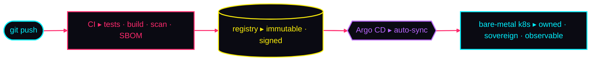

<p align="center">
  
</p>

<p align="center">
  
  
  
  
</p>

## `0x00` BOOT

```console
$ whoami
netrunner // senior devops & platform infrastructure

$ cat /etc/manifesto
> i build the infrastructure cities run on.
> bare metal. kubernetes. gitops. open source end to end.
> no hyperscaler. no proprietary lock-in. no manual changes.
> if it isn't in git, it doesn't exist.
```

## `0x01` MEGACITY GRID

```text
╔══[ SMART CITY // LIVE ]══════════════════════════════════╗
║                                                          ║
║  SECTOR    Montpellier Méditerranée Métropole            ║
║  CITIZENS  500,000+                                      ║
║  SENSORS   100,000+ IoT nodes                            ║
║  FEEDS     air · waste · water · energy · mobility       ║
║  CLUSTERS  4 × Kubernetes, reconciled from Git           ║
║  INFRA     100% owned · zero hyperscaler                 ║
║                                                          ║
╚════════════════════════════════════[ SYNCED · HEALTHY ]══╝
```

## `0x02` THE PIPE



## `0x03` LOADOUT

<p>
  
  
  
  
  
  
  
  
  
</p>

```yaml
loadout:
  platform:      [kubernetes, rke2, rancher, metallb, rook-ceph, cilium/ebpf, envoy-gateway, helm]
  gitops_iac:    [argo-cd, gitlab-ci, opentofu, terraform, ansible]
  iot_rf:        [lorawan at scale, rf planning, vlan segmentation, fleet provisioning, ota]
  observability: [mimir, loki, grafana, alloy, zabbix]
  languages:     [python/django, rust, bash]
  r_and_d:       [computer vision/yolo, gpu scheduling, kubeflow]
```

## `0x04` HOME RIG

```yaml
rig:  # where the grid gets rehearsed
  cluster:  k3s on arm64
  gpu:      nvidia jetson, cuda
  delivery: ci → ghcr, sha-pinned → argo cd auto-sync
  secrets:  sealed, never in git
  rule:     nobody runs kubectl apply by hand
```

## `0x05` OPEN SOURCE DROPS

| node | signal |
|---|---|
| [**OpenHertz / Spectra**](https://github.com/beladjioo/Spectra) | learn radio with a real SDR — all-Rust DSP, live demod in the browser, ADS-B, LoRa, ham-radio exam prep · [openhertz.org](https://openhertz.org) |
| [**chirpstack-v4-kubernetes**](https://github.com/beladjioo/chirpstack-v4-kubernetes) | ChirpStack v4 LoRaWAN network server on Kubernetes |
| [**FineTuneForge**](https://github.com/beladjioo/FineTuneForge) | fine-tune a small open model (1B–7B) on your own data with LoRA, ship it to Hugging Face |
| [**robotique**](https://github.com/beladjioo/robotique) | robotics monorepo — manipulators, navigation, EKF, drones, swarms, RL, ROS 2 |

## `0x06` CERTS

```text
[ CKA ]  Certified Kubernetes Administrator  ::  in progress · 2026 · CNCF
```

## `0x07` UPLINK

<p>
  <a href="https://belhadj.dev"></a>
  <a href="mailto:contact@belhadj.dev"></a>
</p>

<p align="center"><sub>░▒▓ end of transmission ▓▒░</sub></p>
